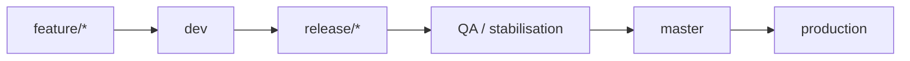
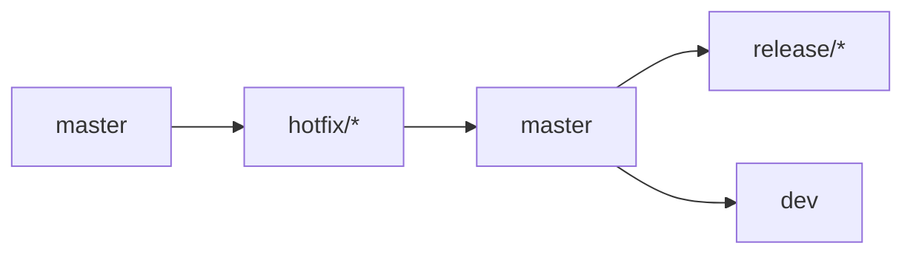

# GitFlow and branch governance

This repository assumes a GitFlow-based organization around protected branches. The intent is to keep the production branch exact, while release branches stabilize and validate upcoming changes before they are promoted.

## Branch roles

- `master`: exact state of production.
- `dev`: integration branch for the next sprint.
- `release/<major>.<minor>`: stabilization branch for a planned release.
- `feature/*`: work in progress on new functionality.
- `fix/*`: corrections during a release.
- `hotfix/*`: emergency production corrections.

## Rules

- Never rebase `master`, `dev`, or `release/*`.
- Rebase is allowed only on personal branches: `feature/*`, `fix/*`, `hotfix/*`.
- Never use `git push --force` on shared branches.
- Use `git push --force-with-lease` only on personal branches after a rebase.
- All protected branches should be configured as protected in GitLab.

## Workflow diagrams





## Feature workflow

```bash
git checkout dev
git pull --ff-only

git checkout -b feature/my-feature
git push -u origin feature/my-feature
```

When the feature is ready:

```bash
git fetch origin
git rebase origin/dev
git push --force-with-lease
```

Then open a Merge Request to `dev`.

## Fix workflow

A release fix is created from a dedicated branch:

```bash
git checkout -b fix/issue-123 release/2.8
```

Then rebase on the target release and open a Merge Request:

```bash
git fetch origin
git rebase origin/release/2.8
git push --force-with-lease
```

MR:

```text
fix/* -> release/2.8
```

## Release workflow

Before creating a release branch, verify that `master` is already in `dev`:

```bash
git fetch origin
git merge-base --is-ancestor origin/master origin/dev
```

If the command fails, stop and merge master into dev first.

Then create the release branch:

```bash
git checkout -b release/2.8 origin/dev
git push -u origin release/2.8
```

## Hotfix workflow

Hotfixes always start from `master`:

```bash
git checkout master
git pull

git checkout -b hotfix/2.8.4
```

After validation:

```bash
git fetch origin
git rebase origin/master
git push --force-with-lease
```

Then open a Merge Request:

```text
hotfix/2.8.4 -> master
```

Finally propagate the fix back to the release and dev lines.

## Protected branches

GitLab should protect the following branches:

- `master`
- `dev`
- `release/*`

Protection should require:

- merge requests,
- at least one approval,
- no direct push, and
- no force-push to the protected branch.
